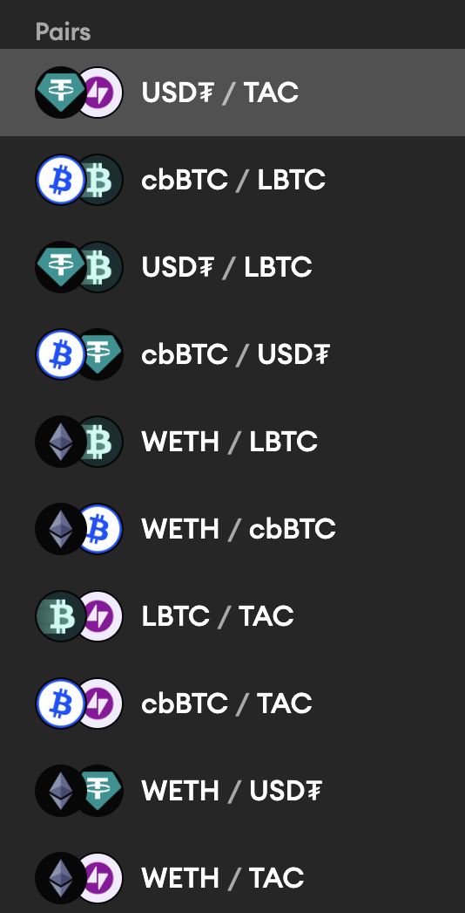

Main Page
https://tac.build/

Type: EVM (rollup for Ton)

Verdict: arbitragable, but Curve is a problem and USDT is from TON..., liquid wrappers for ETH are arbitraged already

Scanner:
https://explorer.tac.build/

Paths:

- WETH -> TAC -> USDT -> USDT Ton -> USDT Arb

DEXes:

- Bancor (better interface for Curve) https://tac.carbondefi.xyz/trade/market?chartStart=%221746144000%22&chartEnd=%221754092800%22&base=0xEeeeeEeeeEeEeeEeEeEeeEEEeeeeEeeeeeeeEEeE&quote=0xAF988C3f7CB2AceAbB15f96b19388a259b6C438f&direction=buy
- https://www.curve.finance/dex/tac/pools/

Bridges:

- Stargate (TAC - Tac,BSC, WETH from Ethereum) https://stargate.finance/bridge
- Native https://bridge.tac.build/
- Hyperlane
- https://cometbridge.app/?original=Arbitrum&target=Eclipse&symbol=ETH

Pairs:

Arbitragable:

- WETH/USDT (very good, arbitragable, but USDT from TON)
- LBTC/USDT (good)
- TAC/USDT (good liquidity, being arbitraged)
- WETH/cbBTC (good, better than LBTC in liquidity)
- WETH/LBTC (good)

Bad pools:

- cbBTC/TAC (low liquidity)
- WETH/TAC (very low liquidity)
- cbBTC/USDT (very low liquidity)
- LBTC/TAC (very low liquidity)

Tokens:

token list https://docs.tac.build/ecosystem/token-list

- ETH (small liquidity, but no arbitragers at all) https://www.curve.finance/dex/tac/pools/factory-twocrypto-3/swap/
- wstETH https://www.curve.finance/dex/tac/pools/factory-stable-ng-10/deposit/
- USN (OFT) (https://app.noon.capital/bridge)
- sUSN (OFT)
