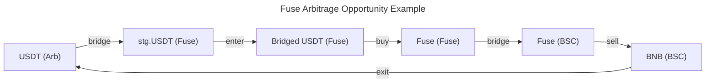
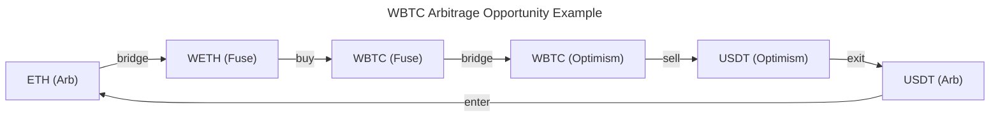

# 2nd Stage

From the first stage Fuse chain showed up as the most promising for cross-chain arbitrage. There 2 bridges available - canonical & Stargate, both implement LZ, which is pretty handy

We already proofed an opportunity by manual labor, now machines must start their part 🤖

The main problem right now is having to manually arbitrage, so our new goal is to build a script (or bot) for automatic opportunity processing

Secondary goal for me is first approximation of arbitrage process formalization. It will not be perfect, but it can be beneficial in future

## Chains

For origin chain we will use Fuse chain and we will try to pair it with:

- Arbitrum
- Optimism
- Base
- BSC
- Ethereum?

## Arbitrage Process

**Lexicon:**

- Base Asset (BA) - asset which we hold and count profits with
- Opportunity Asset (OA) - asset which we arbitrage to gain profit
- Opportunity - situation on market, which can be exploited for profit

All Steps to Arbitrage 💪

1. Pools Discovery
2. Pools Price Monitoring
3. Price Difference Fixation
4. Swapping/Bridging BA to OA
5. Buying OA low
6. Bridging OA
7. Selling OA high
8. Exit to BA

Only pool discovery can be pre-made without needing further actions, so, we will discover all pools beforehand, validate them and then will monitor it's prices

## Liquidity Management

We will be having BA only on one chain. That chain can even not participate in arbitrage.
Pros of this approach are:

- Accounting Simplicity - easy to track profits in $
- No Rebalancing - we don't need to manage multiple account on multiple chains

Cons of this approach are:

- Unnecessary swapping and (or) bridging expenses
- Increased Latency - swapping/bridging means more time to start opportunity processing

This approach is definitely not ideal, but it's simple and it works, exactly what we need.

## Arbitrage Process

### Arbitrage Examples

Real arbitrage examples, that were battle tested manually and we will automate

Some actions during arbitrage may be omitted due to BA being entrance or exit asset

**More Lexicon**

- Entrance Asset - token to be bought with Base Asset to start opportunity execution
- Exit Asset - token to be sold to finish arbitrage opportunity and return back to Base Asset
- Intermediary Asset - token involved in process of entry or exit

Both can be Base Asset due to opportunity specifics

### 1. Pools Discovery

We will be exploring pools on chains listed above using:

- CoinMarketCap (API? 👀)
- GeckoTerminal Web & Public API

### 2. Price Monitoring

Price discovery will be implemented via direct calls to pool contracts

### 3. Price Difference Fixation

To fixate price difference we will have some assumptions:

- Stablecoins cost $1 - it's not true, but it simplifies a lot of stuff
- Everything that contains "BTC" or "ETH" in it's name/symbol, probably, it's price equals to price of BTC or ETH. It's very useful assumption for discovering new opportunities that are not trivial in it's mechanism

We will be using GeckoTerminal Public API to discover prices of intermediary assets that can be involved in arbitrage process

### 4. Swapping/Bridging BA to target chain

### 5. Buying Low

Buying OA from pool of any type

### 6. Bridging OA

Bridge using Stargate, Hydra or OFT mechanism

### 7. Selling OA High

Selling OA on pool with highest price on market

### 8. Exit To BA

If exit asset is not BA, we may need to swap/bridge assets to get back to BA

## Arbitrage Expenses

1. Entry process swap/bridge fees/price impact
2. Buying Low swap fee
3. Bridging fee
4. Selling High swap fee
5. Exit process swap/bridge fees/price impact
6. Tx Costs

If we are considering case of WBTC/ETH arbitrage across Fuse/Arbitrum/Optimism we will be having expenses of around:

- [Bridge](https://arbiscan.io/tx/0xb809539547b4c0122858dd6f622979e8f270ea49884c08c714c34ea59795b0a3) ($0.06)
- [Buying Low](https://explorer.fuse.io/tx/0xa24e7862915410521ef9ae33273407310ae058ef7616cea45b62dfc4c15be2a2) swap fee and price impact / tx cost (<$0.01)
- [Bridge](https://explorer.fuse.io/tx/0xd5382f406f09881f975261f0cfe768cc129e71146b1dcbe27ccec00dfa845d7a) ($0.06)
- [Selling High](https://arbiscan.io/tx/0xa3f3545a7903de0e587055d7b36941a2d43c57b8293287d9911d5eff26971489) swap price impact (~0) & tx cost ($0.005)

With example of Fuse arbitrage we will be having much more expenses in terms of tx costs, but less price impact thanks for better liquidity for that token

## Fuse Chain Details

- Homepage: https://www.fuse.io/
- DEXes:
    - FluxSwap: https://fluxswap.io/
    - Voltage: https://voltage.finance/
    - PancakeSwap: https://pancakeswap.finance/swap
- Explorer: https://explorer.fuse.io/token/0x2F6F07CDcf3588944Bf4C42aC74ff24bF56e7590?tab=holders
- Tokens:
    - ETH: https://explorer.fuse.io/token/0x2F6F07CDcf3588944Bf4C42aC74ff24bF56e7590?tab=holders
    - USDC: https://explorer.fuse.io/token/0xc6Bc407706B7140EE8Eef2f86F9504651b63e7f9
    - USDT: https://explorer.fuse.io/token/0x3695Dd1D1D43B794C0B13eb8be8419Eb3ac22bf7
- Pools:
    - USDC
        - Pools:
            - PegSwap - https://explorer.fuse.io/address/0xFa70dFFeA090fED2d6E9301fB10b0d4C81072E4c
            - AlgebraPool - https://explorer.fuse.io/address/0x677409B2393E2ca19b454fB904F5E634E21D3D89
    - USDT:
        - Pools:
            - Algebra - https://explorer.fuse.io/address/0x677409B2393E2ca19b454fB904F5E634E21D3D89
            - PegSwap - https://explorer.fuse.io/address/0xFa70dFFeA090fED2d6E9301fB10b0d4C81072E4c
            - Algebra - https://explorer.fuse.io/address/0x23518Ca19447E7ABB8C6f6eb215A1D663c53Ea21
            - Algebra - https://explorer.fuse.io/address/0x5E174874C5bc45Ba96bD859A6edA4D34EE9f4424
    - ETH:
        - Pools:
            - https://explorer.fuse.io/address/0x06b6949Fca3706c25A312c1104B7e4fa11ce0BB6
            - https://explorer.fuse.io/address/0xFa70dFFeA090fED2d6E9301fB10b0d4C81072E4c
            - https://explorer.fuse.io/address/0x35E6083f8Fc3a5698942fa02Ebbf1E5D44a71992
            - https://explorer.fuse.io/address/0x51cC986Df4C54877E0Cd9122532db389cc60016B
- Additional Information:
    - Fuse Bridge: https://github.com/fuseio/bridge-v2-contracts

**Identified Arbitragers:**

- https://explorer.fuse.io/address/0x57B814C00639E07EBd2b5a71A9ca5D55D02862E9?tab=txs

### Conclusion

We finished 2nd stage finding ourselves coding lots fo modules for all possible cases without much result. The only opportunity that we successfully exploited was WETH/WBTC on Fuse. This opportunity is viable mostly because of WBTC being bridged via FuseBridge which is a custom bridging solution for Fuse Chain.

Our solution is almost ready to be automated, it lacks stability and error handling, but already shows that it is ready to execute on opportunity

The next step is getting more opportunities via polling more pools. Because WETH/WBTC pool gives projections for $700/monthly optimistically. That's not enough to bootstrap "arbitrage gallera"
